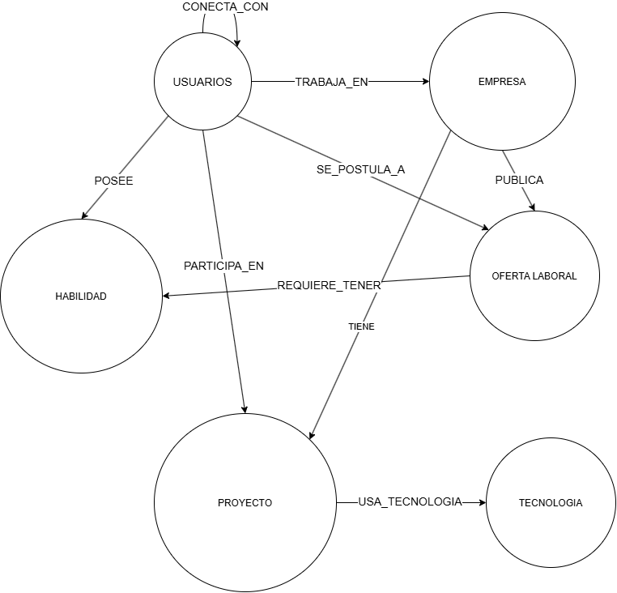

# PROYECTO I+D BASE DE DATOS: BASE DE DATOS DE GRAFOS PARA REDES PROFESIONALES CON NEO4J Y PYTHON


## Librerías
Para ejecutar este proyecto es necesario instalar las dependencias de Python indicadas en `requirements.txt`.

#### Instalación mediante pip
Ejecuta el siguiente comando en la terminal de tu entorno virtual:

```bash
pip install -r requirements.txt
```
## Schema


## Entidades | Propiedades
 * usuarios | (nombre, correo, teléfono, ubicación, experiencia, educación)
 * empresas | (nombre, industria, ubicación, tamaño, descripción)
 * habilidades | (nombre, categoría, nivel)
 * Proyectos | (nombre, descripción, fecha_inicio, fecha_fin, tecnologías)
 * ofertas laborales | (título, descripción, fecha_publicación, fecha_cierre, ubicación, salario, tipo_contrato)
 * tecnologías | (nombre, categoría, versión)

## Funcionalidades
El sistema deberá permitir el registro, almacenamiento, consulta y análisis de dichas conexiones, con el fin de facilitar procesos de búsqueda, recomendación e identificación de oportunidades laborales o colaborativas.

Ejecutar consultas como detección de conexiones entre usuarios, identificación de habilidades compartidas, recomendaciones de contactos y vinculación entre candidatos y vacantes.

## Componente de Investigación
los estudiantes deberán explicar en qué escenarios el modelo de grafos supera al relacional y en cuáles no.

## Requerimientos
- Registrar, consultar, actualizar y eliminar (CRUD) usuarios con información personal y profesional. 
- Relacionar usuarios con otros usuarios mediante conexiones profesionales.
- Vincular usuarios con habilidades, empresas y proyectos.
- Registrar empresas y sus ofertas laborales que publican.
- Relacionar ofertas laborales con las habilidades requeridas.
- Permitir que un usuario se postule a una oferta.
- Consultar caminos y conexiones entre usuarios, empresas y oportunidades laborales.
- Generar recomendaciones de contactos, empleos o colaboradores a partir de la estructura del grafo.
- Mostrar un panel de analítica: usuarios más influyentes, comunidades detectadas y habilidades más demandadas.

## Preguntas a responder
-  ¿Qué usuarios tienen habilidades similares?
-  ¿Qué contactos en común existen entre dos profesionales?
-  ¿Cuál es la ruta más corta entre un usuario y una empresa?
-  ¿Qué candidatos podrían recomendarse para una oferta según sus conexiones y competencias?
-  ¿Qué proyectos comparten tecnologías o miembros relacionados?
-  ¿Qué habilidades son las más demandadas en las ofertas?

